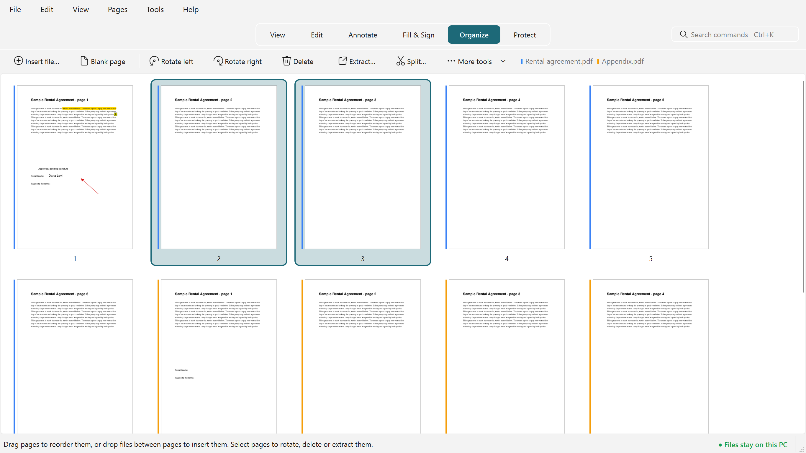

# Sheaf

**A simple, private PDF editor for Windows. Files never leave your computer.**

Sheaf does the everyday PDF jobs in one calm window: read, copy text, combine, reorder, rotate,
delete and extract pages, add text, fill and sign forms, highlight and comment, redact, compress,
protect with a password, and more. It has no account, no uploads and no network code at all, and
it works with the internet unplugged.



## Features

| | |
| --- | --- |
| **View and copy** | Smooth scrolling and zoom, search, select text and copy it with the right line breaks |
| **Organize pages** | Combine files, drag pages to reorder (even between files), rotate, delete, insert blank pages, PDFs or images, extract and split |
| **Edit** | Add text anywhere with font, size, color, bold, italic and alignment; edit words in existing text |
| **Annotate** | Highlight, underline, strike out, sticky notes, boxes, arrows and freehand drawing, with a comments list |
| **Fill & Sign** | Fill form fields (Tab moves between them), type on flat forms, add a drawn, typed or imported signature, check marks, dates and initials |
| **Protect** | True redaction (the content is removed, not covered), remove hidden data, add a password, or save an unlocked copy of a file you have the password for |
| **More tools** | Page numbers, watermarks, compression, text recognition (OCR) for scans, export pages as images, print |

Everything can be undone, a recovery copy protects unsaved work, and Sheaf never overwrites your
original file unless you explicitly choose to.

## Install

**[Download Sheaf-Setup.exe](https://github.com/gadiglikberg/sheaf/releases/latest/download/Sheaf-Setup.exe)** and run it.
It installs for your Windows account only (no administrator password), adds Sheaf to the Start menu and to
**Open with** for PDF files, and can be uninstalled from **Settings → Apps**. A portable `Sheaf-windows.zip` is on
the [Releases](https://github.com/gadiglikberg/sheaf/releases) page too.

Releases aren't code-signed yet, so Windows may say "Windows protected your PC" the first time: click
**More info → Run anyway**. Each release lists SHA-256 checksums so you can verify the download.

**From source** (Python 3.10 or newer):

```bash
git clone https://github.com/gadiglikberg/sheaf.git
cd sheaf
python -m pip install .
sheaf
```

Text recognition (OCR) is optional and needs the free [Tesseract OCR](https://github.com/tesseract-ocr/tesseract)
engine installed. Recognition runs on your computer.

## Keyboard shortcuts

| Action | Keys |
| --- | --- |
| Search all commands | Ctrl+K |
| Open, Save, Save as | Ctrl+O, Ctrl+S, Ctrl+Shift+S |
| Undo, Redo | Ctrl+Z, Ctrl+Y |
| Find, next match | Ctrl+F, F3 |
| Zoom in, out, fit page, actual size, fit width | Ctrl+=, Ctrl+-, Ctrl+0, Ctrl+1, Ctrl+2 |
| Rotate pages right, left | Ctrl+Shift+R, Ctrl+Shift+L |
| Modes: View, Edit, Annotate, Fill & Sign, Organize, Protect | Ctrl+3 to Ctrl+8 |
| Tools: Select, Text, Edit text, Highlight, Note, Draw | V, T, E, H, N, D |

Press F1 in the app for the full list.

## Privacy

- Sheaf contains no networking code. A check in CI (`tools/check_no_network.py`) fails the build if
  any network or process-launching module is ever imported.
- PDF JavaScript is never run, and links inside PDFs are never followed.
- Saved signatures, settings and recovery copies stay in your Windows user profile. Recovery copies
  of password-protected files stay encrypted.

## Development

```bash
python -m pip install -e ".[dev]"
python -m pytest
python tools/check_no_network.py
```

Tests generate every PDF they use; please never add real documents to the repository.
See [CONTRIBUTING.md](CONTRIBUTING.md). Usability and security reviews are in [docs/](docs/).

## Code signing policy

Release files are built only by the [Release workflow](.github/workflows/release.yml) on GitHub Actions, from a
tagged commit on `main`, after the tests, the static security scan and the no-network check pass. Nothing is built
or uploaded from a personal computer.

| Role | Members |
| --- | --- |
| Committers and reviewers | [gadiglikberg](https://github.com/gadiglikberg) |
| Approvers (every release) | [gadiglikberg](https://github.com/gadiglikberg) |

Privacy: this program will not transfer any information to other networked systems unless specifically requested
by the user or the person installing or operating it. In fact it contains no networking code at all.

## License

Sheaf is free software under the [GNU Affero General Public License v3.0](LICENSE). It is built on
[PyMuPDF](https://github.com/pymupdf/PyMuPDF) (AGPL-3.0) and [Qt for Python](https://www.qt.io/qt-for-python) (LGPL-3.0).
